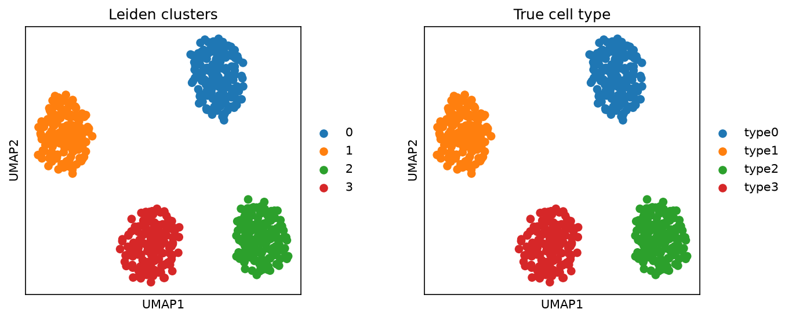

# scflow

A small, transparent single-cell RNA-seq workflow built on [Scanpy](https://scanpy.readthedocs.io): quality control, filtering, clustering and marker genes, with a command-line tool and tests.



*Synthetic data with four known cell types plus low-quality cells. The workflow removes the bad cells and recovers the four types (adjusted Rand index 1.0).*

## Why I wrote it

I have prepared single-nucleus RNA-seq libraries and analysed the data with Scanpy during a research project at IIT Madras. This repository is a new, small project (written in November 2026) that rebuilds the standard steps in a clean, reproducible and tested form, so that every choice (filter thresholds, number of principal components, clustering resolution) is explicit and stored with the result. It contains no data from that project.

## Install

```bash
git clone https://github.com/rahulramalingam123-a11y/sc-rnaseq-workflow.git
cd sc-rnaseq-workflow
python -m venv .venv && source .venv/bin/activate   # Windows: .venv\Scripts\activate
pip install -e ".[dev]" scikit-learn
pytest
```

Requires Python 3.10 or newer.

## Quick start

Offline, on synthetic data with known answers:

```bash
python examples/synthetic_demo.py
```

On the public 10x PBMC 3k dataset (needs internet, about 6 MB):

```bash
python examples/pbmc3k_demo.py
```

On your own data (10x folder, 10x `.h5`, or `.h5ad`):

```bash
scflow run path/to/data --out results --resolution 0.5
```

Outputs: `processed.h5ad` (with raw counts in `layers['counts']` and parameters in `uns['scflow_config']`), `markers.csv`, `umap_leiden.png`.

## What the workflow does

1. **QC metrics:** genes detected, total counts, and percentage of mitochondrial counts per cell (genes starting with `MT-`; change `mito_prefix` for mouse, `mt-`).
2. **Filtering:** a cell is removed if log total counts or log genes detected is more than 5 median absolute deviations (MAD) from the median, or if mitochondrial counts exceed 20%. Genes seen in fewer than 3 cells are removed. The number of cells removed for each reason is stored in `uns['qc_summary']`.
3. **Normalisation:** counts scaled to 10,000 per cell, then log1p. Raw counts are kept.
4. **Feature selection and PCA:** 2,000 highly variable genes, scaled, then PCA (30 components).
5. **Graph, embedding, clustering:** k-nearest-neighbour graph, UMAP, Leiden clustering.
6. **Markers:** Wilcoxon rank-sum test per cluster.

All thresholds are fields of `PipelineConfig`.

## Tests

`pytest` runs 8 tests: the MAD rule flags planted outliers and nothing else, mitochondrial fractions are higher in planted bad cells, the filter removes the planted bad cells while keeping at least 95% of good ones, the full pipeline recovers four planted cell types (adjusted Rand index above 0.9), the top markers are the planted marker genes, results are deterministic for a fixed seed, and the command-line tool writes its outputs. GitHub Actions runs them on Python 3.10 to 3.13.

## Limitations

- No doublet detection, ambient-RNA correction or batch integration. For multiple samples, integrate before clustering (for example with Harmony or scVI).
- Clusters are not annotated automatically; use the marker table and known markers.
- Synthetic data are far cleaner than real data, so recovery scores there demonstrate that the code works, not how it performs on biological data.
- Thresholds (5 MADs, 20% mitochondrial) are common defaults, not universal; check the distributions for each dataset.

## Author and AI assistance

Rahul Ramalingam, M.Sc. Pharmaceutical Biotechnology (University of Padua). This project was developed with assistance from Claude (Anthropic) for code and tests; the workflow steps and limitations are described above so they can be checked by reading the code and running `pytest`.

## License

MIT, see `LICENSE`.
